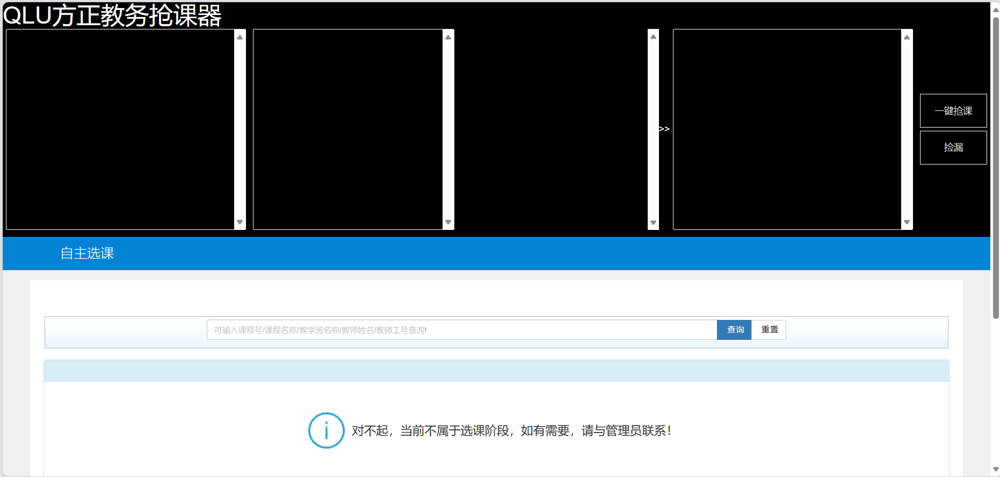
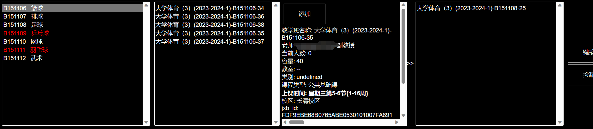

# QLU 抢课助手（方正教务）

齐鲁工业大学方正教务系统抢课工具集，包含三种形态，可单独或组合使用。经实践适配选课页面 `*/jwglxt/xsxk/zzxkyzb_cxZzxkYzbIndex.html*`。

> ⚠️ 仅供个人学习与自用，请控制请求频率，勿对教务系统造成压力。请遵守学校相关规定。

## 致谢

本项目基于 [NixiakAI/QLU_rush_class](https://github.com/NixiakAI/QLU_rush_class)（作者：Nixiak）二次开发：
原仓库提供了油猴脚本与 Python 发包脚本两种方案；本仓库在原方案基础上新增了 `web_server/` 多用户网页版，并对脚本做了整理与安全处理。感谢原作者的开源分享。

## 三种方案

| 方案 | 目录 | 形态 | 适用场景 |
|---|---|---|---|
| 🖥️ 油猴脚本 | `userscript/qlufz.js` | 浏览器用户脚本（Tampermonkey） | 日常网页端抢课，自动拉取课程与教学班、循环捡漏 |
| 🐍 Python 发包 | `python-cli/教务抢课脚本.py` | 命令行脚本 | 网页崩溃时直连接口发包，可与油猴脚本同时运行 |
| 🌐 服务器网页版 | `web_server/` | FastAPI 多用户 Web 服务 | 多人共用一台服务器，各自填 Cookie 与课程参数，独立抢课、实时日志 |

## 快速开始

### 1. 油猴脚本

安装 Tampermonkey → 新建脚本 → 粘贴 `userscript/qlufz.js` 内容 → 保存。打开教务选课页即可看到抢课面板。

### 2. Python 发包

```bash
cd python-cli
python 教务抢课脚本.py
```

首次运行会提示先抓包替换脚本中的 JSESSIONID 与课程参数（F12 → 网络 → 选中课请求 → 复制 Cookie 与表单参数）。

### 3. 服务器网页版（多用户）

详见 [web_server/README.md](web_server/README.md)。核心命令：

```bash
cd web_server
docker build -t qlu-server .
docker run -d --name qlu-server --restart unless-stopped \
  -p 8010:8000 -v $(pwd)/data:/data qlu-server
```

打开 `http://服务器IP:8010` → 注册账号 → 填 Cookie 与课程参数 → 开始抢课。

## 目录结构

```
QLU_rush_class-main/
├── userscript/qlufz.js        # 油猴脚本（浏览器端）
├── python-cli/                # Python 发包脚本（命令行端）
├── web_server/                # 服务器网页版（FastAPI 多用户）
│   ├── app.py                 # 后端 + 抢课引擎 + 多用户认证
│   ├── static/index.html      # 网页控制台
│   ├── Dockerfile             # Linux Docker 部署
│   └── tests/                 # 冒烟测试（打 mock，不打真实教务）
└── images/                    # 使用效果截图
```

## 使用效果




